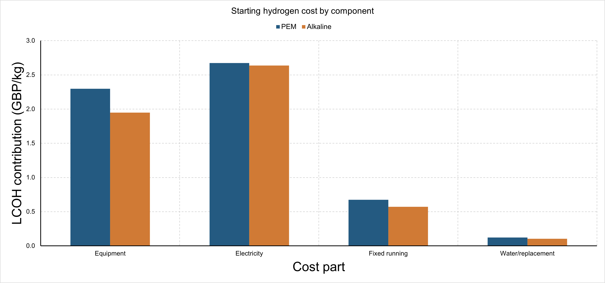

# A UK-focused techno-economic study of hydrogen production costs

This UK-focused study explains how electricity price, yearly plant use, equipment cost and efficiency affect hydrogen production cost. It uses public NESO assumptions, a checked Python model, Excel charts and Design-Expert charts.


## Read the results

- [Final report](docs/FINAL_REPORT.md).
- [Three report examples](docs/REPORT_MODELS.md).
- [Editable Excel charts](data/Report_Charts_Excel.xlsx).
- [Native Design-Expert project](design_expert/NESO_three_factor_cost_model.dxpx).
- [Excel data for the three-factor Design-Expert study](design_expert/NESO_three_factor_surface.xlsx).
- [Excel data for electricity price and yearly use](data/NESO_price_and_plant_use_Design_Expert.xlsx).
- [Design-Expert reproduction guide](design_expert/REPRODUCE.md).
- [Final checks](data/release_checks.json).



## What the study finds

The starting assumptions give GBP 5.77/kg for PEM and GBP 5.26/kg for alkaline. Both use GBP 50/MWh electricity, 50% yearly use, an 8% finance rate and a 25-year life. These are costs on the **NESO source-money scale**.

Cheap electricity alone does not guarantee cheap hydrogen. In one PEM comparison, GBP 10/MWh power at 25% use gives GBP 6.60/kg. GBP 50/MWh at 75% use gives GBP 4.78/kg. Higher output spreads equipment and fixed costs over more hydrogen.

A less efficient machine must save enough equipment cost to offset its higher energy use. At GBP 50/MWh and 50% use, increasing consumption from 48 to 53 kWh/kg needs an equipment-price reduction of about 18% from GBP 2,000/kWe to keep hydrogen cost unchanged.

These are calculated relationships under stated assumptions. They are not current equipment offers or demonstrated power-supply contracts.

## What is included

The model includes installed equipment, discounted finance, electricity, fixed running costs, and the source allowance for water and stack replacement. Extra compression, storage, transport, fuel synthesis, taxes and subsidies are outside the boundary.

The core cost equation is:

    annual_hydrogen = 8760 * use_fraction / electricity_kWh_per_kg
    LCOH = (CAPEX * recovery_factor + annual_fixed_cost) / annual_hydrogen
           + electricity_kWh_per_kg * electricity_price_GBP_per_kWh
           + variable_cost_GBP_per_kg

The code also checks this result with yearly discounted costs and hydrogen output.

## Reproduce from the saved inputs

Use Python 3.10 or later. The release was checked with Python 3.12.14. Install the dependencies, then run:

```text
python -m pip install -r requirements.txt
python scripts/run_project.py
```

This rebuilds the main scenario tables. Report charts are saved Excel and Design-Expert exports. It uses the saved source snapshot and needs no network access. It validates the saved native Design-Expert equation and checks all report links. To refresh chart images after changing inputs, update the native chart files and export from Excel or Design-Expert.

The saved Design-Expert file opens in Design-Expert 13. Its fit and charts can be recreated using [these steps](design_expert/REPRODUCE.md). The Excel tables contain fixed calculated values. Editing an Excel input does not recalculate all outputs. Rerun the Python study to refresh them.

To check only the central model:

```text
python scripts/test_cost_model.py
```

To rebuild the inputs from the saved original NESO downloads:

```text
python scripts/prepare_step02.py
python scripts/run_project.py
```

To acquire a new source snapshot, run `python scripts/fetch_sources.py` in a separate copy first. Source changes can alter results. Review any change before replacing this snapshot.

## Evidence and checks

| Check | Coverage |
|---|---|
| Published NESO output comparison | 54 selected cases, with cost parts and totals |
| Electricity price and yearly use | 1,178 calculated cases |
| Equipment/efficiency grid | 11,163 points checked against yearly discounted costs |
| Local input screen | 28 cases |
| Efficiency-loss compensation | 54 solved cases |
| Native Design-Expert sample | 125 imported Excel cases |
| Native fitted-model check | 200 separate model points; maximum error about GBP 0.000000101/kg |
| Separate government reconstruction | 14 free-power cases within stated input-rounding bounds |

The charts show calculated scenarios. The supporting files contain the numerical checks.

## Data and assumptions

NESO's 2025 Central inputs define the starting cases. Wider equipment ranges include source assumptions for 2025–2050. Crossed equipment-cost and energy-use values are hypothetical combinations, not a catalogue of available machines.

The source has small inconsistencies between electrical-input and hydrogen-output CAPEX columns in six 2025 rows. The model uses the output-cost column and HHV efficiency to reproduce published results. Both original values are retained. See [starting inputs](data/starting_case.json) and [data checks](data/step02_data_checks.json).

These are costs on the **NESO source-money scale**.

The UK government 2021 annex is a separate reference. Its 2020-pound model is not mixed into the NESO starting case. The 14 government cases check construction timing and cost arithmetic. Their largest total difference is 0.172 pence/kg.

## Files

- `scripts/`: calculations and checks.
- `data/`: source-linked inputs, scenario CSVs and check records.
- `data/raw/`: saved NESO downloads and provenance manifests.
- `design_expert/`: Excel sample, native project and chart instructions.
- `figures/`: four Excel chart exports and three Design-Expert exports.
- `docs/`: final report and supporting explanations.


## Sources and attribution

- [NESO dataset](https://www.neso.energy/data-portal/levelised-cost-green-hydrogen).
- [NESO input assumptions](https://www.neso.energy/data-portal/levelised-cost-green-hydrogen/capex_and_opex_input_assumptions_for_pem_and_alkaline_electrolyser_systems).
- [UK government Hydrogen Production Costs 2021](https://www.gov.uk/government/publications/hydrogen-production-costs-2021), used separately.

Supported by National Energy SO Open Data. NESO data retain the [NESO open licence](https://www.neso.energy/data-portal/neso-open-licence). Other source materials retain their original terms. This release does not assign a new licence to third-party data. A licence for the original project code has not yet been selected.

The portfolio statement is: “A reproducible techno-economic study of electrolytic hydrogen using public NESO assumptions, discounted cost modelling, sensitivity analysis and Design-Expert response surfaces.” It should be used after reviewing and understanding the model and its limits.

The calculations and report were developed with AI assistance. All report charts are native Excel or Design-Expert charts. The source data, code and native chart files are included.
