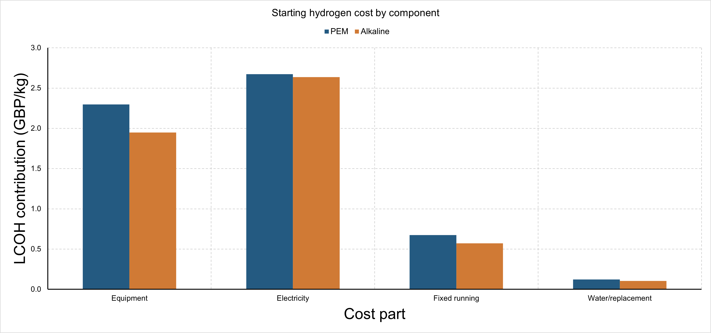
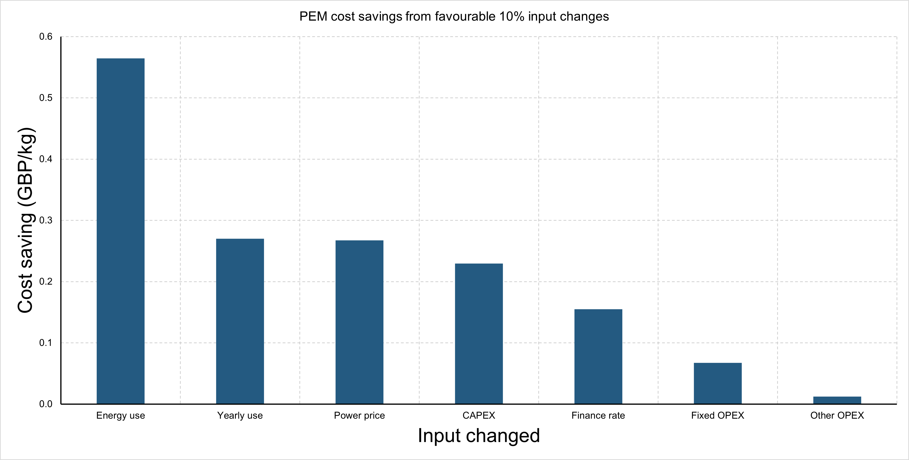
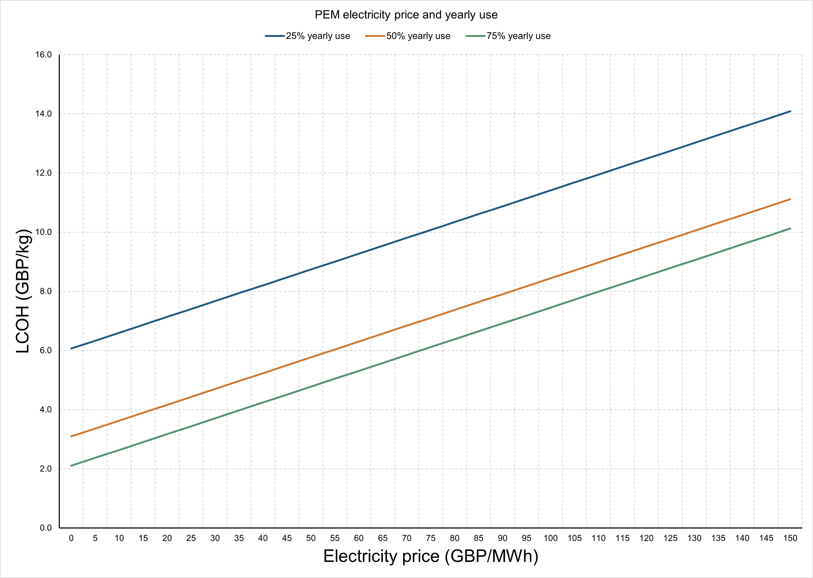
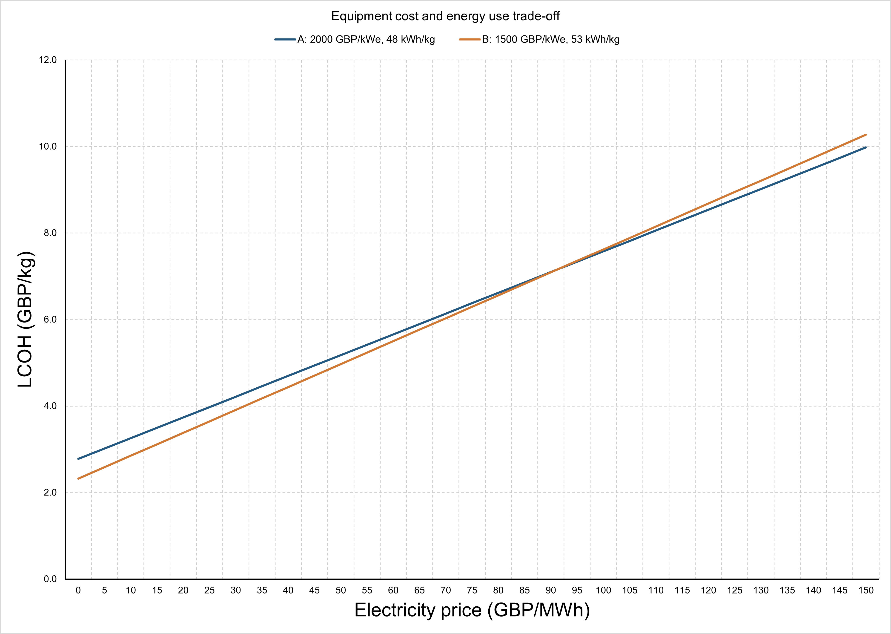
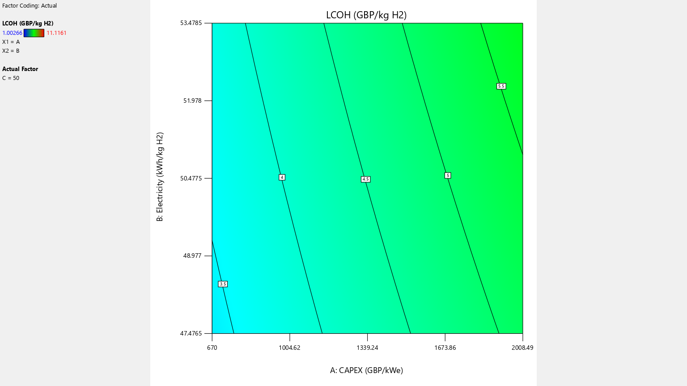
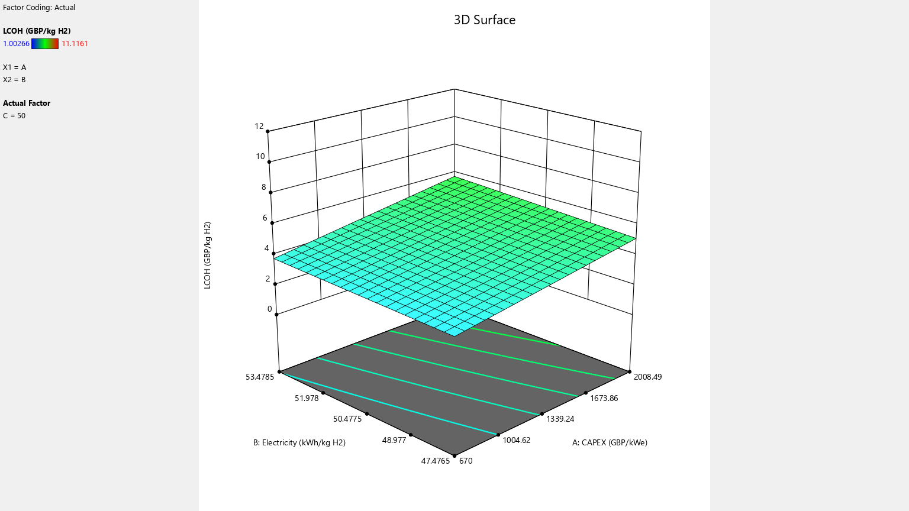
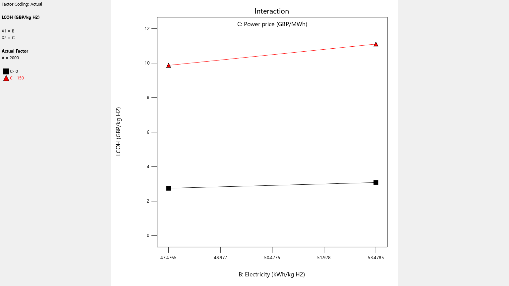

# A UK-focused techno-economic study of hydrogen production costs

## Summary

This UK-focused study examines how electricity price, yearly plant use, equipment cost and electricity consumption affect the levelised cost of hydrogen (LCOH). It uses NESO cost assumptions to compare proton exchange membrane (PEM) and alkaline electrolysis. It also examines when better efficiency is worth a higher equipment price.

The starting case gives **£5.77/kg for PEM** and **£5.26/kg for alkaline**. Electricity and equipment account for most of this cost. Cheap electricity helps, but the number of hours the plant runs also matters.

A cheaper electrolyser can produce cheaper hydrogen even if it uses more electricity. Its equipment saving must cover the extra energy cost. At £50/MWh and 50% yearly use, increasing consumption from 48 to 53 kWh/kg needs an equipment saving of about **18%** to keep LCOH unchanged.

These are costs on the **NESO source-money scale**.

## 1. Aim

The aim is to identify which changes reduce the cost of producing hydrogen by electrolysis in a UK-focused study. The analysis uses NESO cost assumptions and electricity-price scenarios expressed in pounds sterling. It examines power price and yearly plant use together, then finds how much equipment cost must fall to offset lower efficiency.

There are four objectives:

1. Calculate LCOH for PEM and alkaline using a common set of operating assumptions.
2. Measure how changes in individual inputs affect LCOH.
3. Examine electricity price and yearly plant use together.
4. Find the equipment saving needed to offset higher electricity consumption.

The results are calculated scenarios under the assumptions below. The electricity prices are modelling choices, not prices from a specific UK power contract.

## 2. Data and assumptions

### 2.1 Data source

The main inputs come from the National Energy System Operator (NESO) [Levelised cost of green hydrogen dataset](https://www.neso.energy/data-portal/levelised-cost-green-hydrogen). The input table has 36 rows. It covers two technologies, three cost cases and six build years. The starting case uses the **2025 Central** assumptions.

NESO provides equipment cost, efficiency, running costs and plant life. The equipment study uses the ranges across these cases, including future design assumptions. The combinations tested are hypothetical designs.

### 2.2 Cost boundary

The study includes installed equipment, electricity, fixed running costs, and the NESO allowance for water and stack replacement. The replacement allowance is counted once. The discount rate represents the time value of money.

Extra compression, storage, delivery, fuel synthesis, taxes and subsidies are outside the study. Plant ageing and hourly operation are not modelled. Electricity price and yearly use are tested as separate inputs.

Equipment cost is stated per kW of electrical input capacity, written as kWe. This gives both technologies the same basis for comparison. A cost per kWe is different from the total investment in a plant.

### 2.3 Starting assumptions

| Input | PEM | Alkaline |
|---|---:|---:|
| Installed equipment cost, £/kWe | 2,008.49 | 1,728.09 |
| Electricity consumption, kWh/kg | 53.4785 | 52.7228 |
| HHV efficiency | 73.62% | 74.67% |
| Fixed running cost, £/kWe/year | 55.2333 | 47.5226 |
| Water and replacement allowance, £/kg | 0.1226 | 0.1040 |
| Plant life, years | 25 | 25 |
| Electricity price, £/MWh | 50 | 50 |
| Yearly plant use | 50% | 50% |
| Discount rate | 8% | 8% |

Electricity price, yearly use and discount rate are selected study settings. A yearly use of 50% means 4,380 equivalent full-load hours each year. HHV means higher heating value, the hydrogen-energy basis used by NESO.

Six source rows have small differences between the two equipment-cost columns. To match NESO's published results, the model uses its hydrogen-output cost column and HHV efficiency. Both original columns are kept in the data. The resulting PEM input is £2,008.49/kWe. The separately reported electrical-input value is £2,010/kWe.

Source: [NESO input assumptions](https://www.neso.energy/data-portal/levelised-cost-green-hydrogen/capex_and_opex_input_assumptions_for_pem_and_alkaline_electrolyser_systems). The [saved starting inputs](../data/starting_case.json) contain the full values used in the calculation.

## 3. Methodology

### 3.1 LCOH calculation

LCOH is the discounted lifetime cost divided by discounted lifetime hydrogen output. It gives a production cost in pounds per kg. It does not set the market selling price.

For each kWe of installed capacity, annual hydrogen production is:

$$
Q = \frac{8760u}{e}
$$

Q is annual hydrogen output in kg/kWe/year. The yearly-use fraction is u, and electricity consumption in kWh/kg is e.

The capital recovery factor spreads the initial equipment investment over the plant life:

$$
CRF = \frac{r(1+r)^N}{(1+r)^N-1}
$$

The annual discount rate is r, and plant life in years is N. At 8% and 25 years, CRF is 0.0936788.

The cost equation is:

$$
LCOH = \frac{K\times CRF+F}{Q}+ep+v
$$

| Symbol | Meaning | Unit |
|---|---|---|
| K | Installed equipment investment | £/kWe |
| F | Annual fixed running cost | £/kWe/year |
| p | Electricity price | £/kWh |
| v | Water and replacement allowance | £/kg |
| LCOH | Levelised cost of hydrogen | £/kg |

The fraction gives equipment and fixed running costs per kg. The product ep gives electricity cost per kg. The allowance v adds water and replacement costs.

In the PEM starting case, annual output is 81.9021 kg/kWe. Annual equipment cost is £188.1524/kWe. Dividing equipment cost by output gives £2.2973/kg. The four cost parts sum to £5.7682/kg.

### 3.2 Sensitivity and trade-off studies

The first test changes one input at a time by 10% relative to its starting value. It tests both directions for seven inputs and two technologies. This gives 28 cases. The equipment-cost test holds annual fixed running cost constant to isolate the investment effect.

The second test combines electricity prices from £0 to £150/MWh with yearly use from 5% to 95%. It gives 1,178 cases across both technologies.

The equipment study combines installed investment (CAPEX) from about £670 to £2,008.49/kWe with electricity consumption from 47.48 to 53.48 kWh/kg. It contains 11,163 calculated points at three electricity prices. Yearly use stays at 50%. Fixed running cost follows equipment cost at 2.75% per year. The water and replacement allowance stays at £0.122615/kg.

The final trade-off calculation finds the equipment price that offsets an increase in electricity consumption. It covers 54 cases. For a reference design 1 and a design 2 with higher energy use:

$$
\alpha=\frac{CRF+f}{8760u},\qquad
K_2=\frac{e_1(K_1\alpha+p)/e_2-p}{\alpha}
$$

The annual fixed-cost fraction f is 0.0275. Both designs use the same yearly use, discount rate, life and variable allowance. The equation sets their LCOH values equal and solves for the equipment price of design 2.

### 3.3 Calculation checks

The cost model reproduces the cost parts and totals of 54 selected published NESO cases. A second calculation discounts costs and hydrogen output year by year. It agrees with the annual-cost method for all 1,178 price-and-use cases.

The calculation method was also checked using the [UK Hydrogen Production Costs report and Excel annex](https://www.gov.uk/government/publications/hydrogen-production-costs-2021). This check rebuilt 14 central curtailed-electricity cases for PEM and alkaline. These use free electricity, 25% yearly use, a 10% discount rate and 30 operating years. Construction spending is split equally across three years before operation.

| Government check | Published cost | Rebuilt cost |
|---|---:|---:|
| PEM, 2025 case, £/kg | 2.2976 | 2.2985 |
| Alkaline, 2025 case, £/kg | 2.2843 | 2.2837 |

Across all 14 cases, the largest total difference is **£0.001717/kg**, or **0.172 pence/kg**. All cost parts and totals fall within the stated input-rounding bounds. This check uses the government's own real 2020-pound inputs and construction timing. It checks the method separately from the NESO results. Full results are in the [government comparison table](../data/uk_reference_reproduction.csv).

### 3.4 Charts

Figures 1–4 are native Excel charts. Figures 5–7 were exported from Design-Expert 13. The Design-Expert study uses 125 calculated cases imported from Excel. It tests five levels of equipment cost, electricity consumption and electricity price. Yearly use remains 50%.

The charts show calculated model results. The [Excel chart workbook](../data/Report_Charts_Excel.xlsx) and [Design-Expert project](../design_expert/NESO_three_factor_cost_model.dxpx) contain the chart data and settings.

## 4. Starting hydrogen cost

| Cost part, £/kg | PEM | Alkaline |
|---|---:|---:|
| Equipment and finance | 2.2973 | 1.9486 |
| Electricity | 2.6739 | 2.6361 |
| Fixed running cost | 0.6744 | 0.5720 |
| Water and replacement | 0.1226 | 0.1040 |
| **Total LCOH** | **5.7682** | **5.2608** |

*Figure 1. Starting cost components for PEM and alkaline. Chart exported from Excel.*

Electricity is the largest cost part in both cases. Equipment is the second largest. Together, they account for about 86% of PEM cost and 87% of alkaline cost.

Alkaline has the lower LCOH in the starting case. Its equipment cost and electricity consumption are both lower than the PEM inputs. This result applies to the selected NESO assumptions.

## 5. Which inputs have the largest effect?

*Figure 2. PEM savings from favourable 10% relative input changes. Each input changes separately. Chart exported from Excel.*

| Change from the PEM starting case | LCOH saving, £/kg |
|---|---:|
| Electricity consumption falls by 10% | 0.565 |
| Yearly use rises from 50% to 55% | 0.270 |
| Electricity price falls from £50 to £45/MWh | 0.267 |
| Equipment cost falls by 10% | 0.230 |
| Discount rate falls from 8% to 7.2% | 0.155 |
| Fixed running cost falls by 10% | 0.067 |
| Water and replacement allowance falls by 10% | 0.012 |

Reducing electricity consumption gives the largest saving in this test. It cuts electricity spending per kg and produces more hydrogen from the same electrical capacity. Equipment and fixed costs are then shared over more output.

This test holds equipment price fixed when consumption changes. Section 7 examines the trade-off between equipment cost and energy performance. A 10% change in one input may be easier to achieve than a 10% change in another. The ranking measures the cost effect near the starting case.

The water and replacement allowance has a smaller effect here. It remains in the cost model and stays constant in the main trade-off studies. Plant life also stays at 25 years.

## 6. Electricity price and plant use

*Figure 3. PEM LCOH at three yearly-use levels. Other starting assumptions stay fixed. Chart exported from Excel.*

LCOH rises with electricity price at every use level. Higher yearly use lowers LCOH because the same installed equipment produces more hydrogen.

| PEM case | Electricity price, £/MWh | Yearly use | LCOH, £/kg |
|---|---:|---:|---:|
| Low price, shorter operation | 10 | 25% | 6.60 |
| Starting case | 50 | 50% | 5.77 |
| Higher use | 50 | 75% | 4.78 |

At 25% use, equipment and fixed running costs total £5.94/kg. At 75% use, they total £1.98/kg. This explains why the higher-price case can still produce cheaper hydrogen.

Power price and operating hours need to be assessed together. This study varies them independently. In a real supply contract, a low price may be available for only part of the year.

## 7. Equipment cost and efficiency

### 7.1 Comparing two designs

| Design | Equipment cost, £/kWe | Electricity consumption, kWh/kg |
|---|---:|---:|
| A: more efficient, higher price | 2,000 | 48 |
| B: less efficient, lower price | 1,500 | 53 |

These are hypothetical designs within the source input ranges. Both use 50% yearly use, an 8% discount rate and a 25-year life. Annual fixed running cost is 2.75% of equipment cost.

*Figure 4. LCOH for the two designs as electricity price changes. Chart exported from Excel.*

| Electricity price, £/MWh | Design A, £/kg | Design B, £/kg |
|---|---:|---:|
| 10 | 3.26 | 2.85 |
| 50 | 5.18 | 4.97 |
| 150 | 9.98 | 10.27 |

At low electricity prices, Design B saves more on equipment than it spends on extra electricity. At high prices, the lower electricity consumption of Design A becomes worth its higher equipment price. Their costs are equal at about **£91.30/MWh**.

### 7.2 Required saving for lower efficiency

Design A costs £2,000/kWe and uses 48 kWh/kg. For a design using 53 kWh/kg, the table gives the highest equipment price that keeps LCOH unchanged at 50% yearly use.

| Electricity price, £/MWh | Equipment-price limit, £/kWe | Required saving |
|---|---:|---:|
| 10 | 1,777.22 | 11.14% |
| 50 | 1,640.83 | 17.96% |
| 150 | 1,299.84 | 35.01% |

At £50/MWh, the less efficient design needs an equipment saving of about 18%. At a higher electricity price, it needs a larger saving.

At £50/MWh, the required equipment saving is 13.70% at 25% use. It rises to 22.22% at 75% use. A plant that runs more often buys more electricity each year, so reducing consumption saves more over its life.

### 7.3 Design-Expert plots

*Figure 5. Design-Expert contour plot at £50/MWh and 50% yearly use.*

Each contour line joins combinations with the same LCOH. Along a line, lower equipment cost offsets higher electricity consumption. Lowering both inputs reduces LCOH.

*Figure 6. Design-Expert surface at £50/MWh and 50% yearly use. The colour and vertical scales cover the full three-factor study.*

The surface shows the same relationship in three dimensions. Higher equipment cost or higher energy consumption raises LCOH.

*Figure 7. Design-Expert interaction plot at £2,000/kWe and 50% yearly use. The lines compare £0/MWh and £150/MWh.*

The high-price line is steeper because an extra kWh per kg costs more at £150/MWh than at £0/MWh. Better efficiency therefore saves more when power is expensive.

## 8. Conclusions

Under the selected NESO assumptions, the UK-focused starting case gives £5.77/kg for PEM and £5.26/kg for alkaline. Electricity and equipment account for most of this cost.

Lower electricity consumption gives the largest saving in the local 10% test. Lower power prices, higher yearly use and lower equipment cost also reduce LCOH. Financing matters: reducing the discount rate from 8% to 7.2% saves £0.155/kg in the PEM case.

Power price and plant use need to be considered together. In the PEM comparison, £10/MWh at 25% use gives £6.60/kg. At £50/MWh and 75% use, the cost falls to £4.78/kg.

Better efficiency can justify a higher equipment price. Its value rises with electricity price and yearly use. At £50/MWh and 50% use, a design using 53 kWh/kg needs about 18% lower equipment cost than a £2,000/kWe design using 48 kWh/kg.

Equipment selection should account for power price and operating hours. A higher purchase price can be justified when the lifetime electricity saving is large enough.

## Sources and supporting files

- [NESO dataset](https://www.neso.energy/data-portal/levelised-cost-green-hydrogen) and [input assumptions](https://www.neso.energy/data-portal/levelised-cost-green-hydrogen/capex_and_opex_input_assumptions_for_pem_and_alkaline_electrolyser_systems).
- [UK Hydrogen Production Costs report and annex](https://www.gov.uk/government/publications/hydrogen-production-costs-2021), used for the calculation check in Section 3.3.
- [Full calculations and reproduction instructions](../README.md).
- [Excel charts](../data/Report_Charts_Excel.xlsx), [Design-Expert input workbook](../design_expert/NESO_three_factor_surface.xlsx) and [native project](../design_expert/NESO_three_factor_cost_model.dxpx).
- [Sensitivity results](../data/neso_driver_screen.csv), [price-and-use results](../data/neso_joint_price_use.csv) and [equipment-saving results](../data/neso_efficiency_loss_compensation.csv).

**Supported by National Energy SO Open Data.** NESO data retain the [NESO open licence](https://www.neso.energy/data-portal/neso-open-licence). Other source materials retain their original terms.
